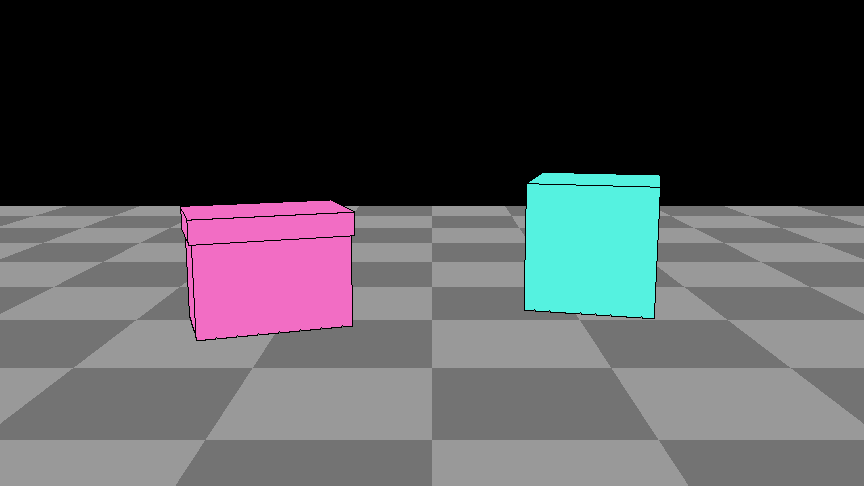
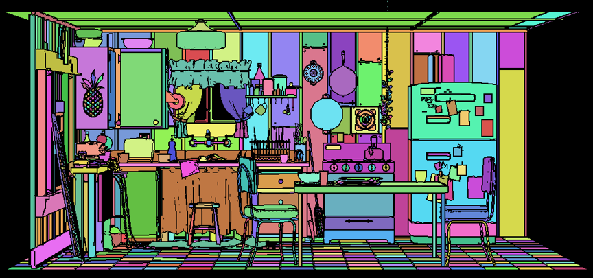
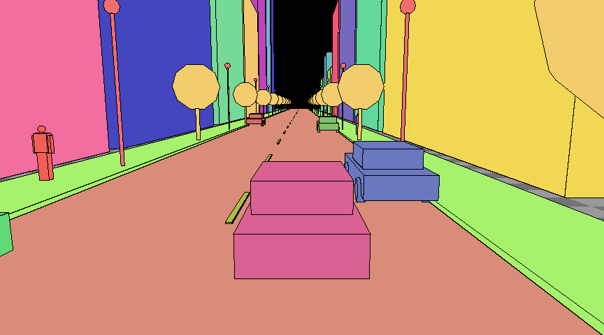

# hdPhantasos

An OpenUSD Hydra render delegate that turns simple, described prims into
generated pictures. A fast CPU rasterizer draws the stage as a flat-coloured
guide (the *proxy*), the prims' descriptions say what each thing is, and a
local PyTorch model paints the picture from both.

Phantasos was the god who sent dreams of things (objects, landscapes, water and
stone) rather than of people. Here he turns boxes into a world.

> **Status: phase 1b.** The delegate, the proxy and the descriptions work in
> usdview and usdrecord, on Windows and Linux. Generation works with two
> models: FLUX.2 Klein 4B (stills) and Matrix-Game 4.0 racing (streaming,
> about 20 frames a second), through usdrecord and, for Matrix-Game, in the
> usdview viewport. See [docs/roadmap.md](docs/roadmap.md).

| The example stage, as the model will see it | Pixar's Kitchen set, undescribed (1,788 meshes, 77 ms) |
|---|---|
|  |  |

## Examples

| Stage | What it is |
|---|---|
| [examples/floor_two_boxes.usda](examples/floor_two_boxes.usda) | A floor, a chest made of two cubes, and a crate: the smallest described stage |
| [examples/city_drive.usda](examples/city_drive.usda) | A city street driven from behind a sedan, laid out like Matrix-Game 4.0's City Racing scene: 35 described subjects (20 buildings, parked cars, pedestrians, lamps, trees, road, lane markings), 120 frames at 24 fps with a chase camera. Written by [examples/make_city_drive.py](examples/make_city_drive.py): edit that, not the .usda |



All 120 frames of the city drive render in 5.4 s through usdrecord, start-up included.

## Describing a stage

Each prim says what it is through constant primvars, declared by the codeless
`PhantasosAPI` schema ([schema/](schema/)). Constant primvars are inherited
down the namespace, so describing a group describes every mesh under it:

```usda
def Xform "chest" (prepend apiSchemas = ["PhantasosAPI"])
{
    string primvars:phantasos:subject = "chest"
    string primvars:phantasos:description = "an old oak chest bound in green iron"
    bool   primvars:phantasos:hasFront = 1          # its +Z is its front
    def Cube "body" { ... }
    def Cube "lid"  { ... }
}
```

| Primvar | Meaning |
|---|---|
| `phantasos:subject` | Meshes with the same key are one subject: one description, one colour. Unset, each mesh is its own subject, keyed by its path |
| `phantasos:description` | What the subject is and looks like, in plain words |
| `phantasos:role` | `subject` (flat colour), `hero` (the subject the shot follows, such as the car being driven: a subject, described first), `ground` (grey checkerboard), `backdrop` (flat colour, described last) |
| `phantasos:hasFront` | The prompt says which way the subject faces |
| `phantasos:reference` | An image of the subject, for the model as a reference picture |
| `phantasos:proxyColor` | The proxy colour, sRGB; unset, derived from the key, the same in every session |

The schema is optional: the delegate reads the primvars, which reach it with or
without the schema loaded. With it, the properties are typed, documented, and
shown as such in a host's UI.

Every prim type the stage is built from works: `Mesh`, and `Cube`, `Sphere`,
`Cylinder`, `Cone`, `Capsule` and `Plane`, which a scene index plugin turns
into meshes. Point and native instancing work. There are no materials or
lights: the proxy is flat colour by design.

### Editing descriptions in usdview

**Phantasos > Parameters...** in usdview opens a window beside the viewport
for the selected prims, with every PhantasosAPI parameter and its
documentation (both read from the schema, so a parameter added to
`schema/schema.usda` shows up there):

- Each parameter's box is ticked when the selected prims author it. Tick it to
  add it, untick it to remove it; editing a value adds it too, and applies
  PhantasosAPI to the prim if it is missing.
- A value the prims inherit from a group above them shows greyed, with where
  it comes from and a **Select source** link to go and edit it there (on the
  group, it changes the whole subject).
- With several prims selected, an edit applies to all; values they do not
  share show as several values.
- Edits go to the root layer (saved with **Save**) or the session layer (gone
  when usdview closes), and the viewport shows them at once. A change to the
  shot starts a new Matrix-Game stream.
- Untick **Follow selection** to keep editing the same prims while you select
  others.

## What the delegate produces

- **AOVs:** `color` (the proxy, linear), `depth`, `normal`, `primId`,
  `instanceId`, `elementId`, and `subjectId` (which subject each pixel shows).
- **A manifest** for each frame when `HDPHANTASOS_MANIFEST` names a
  directory: `manifest.json` (every subject with its description and role, and
  what the frame shows of it: coverage, box, centroid, distance, mean world position, and which way
  it faces) and `proxy.png` (the guide, 8-bit sRGB). This is what the model
  worker will read.

The proxy follows the training proxies of Matrix-Game 4.0: flat colour per
subject, black outlines between primitives and along creases, a grey checker
ground and a black sky.

## Generating pictures

Turn on **Generate pictures** (or `HDPHANTASOS_GENERATE=1`) and the delegate
hands each view to a model worker: the proxy goes in, a picture comes back and
replaces the proxy in the colour AOV. The proxy shows at once while the picture
is made; a newer view replaces a request still waiting, so orbiting never
builds a queue. usdrecord waits for each frame's picture.

The first model is **FLUX.2 [klein] 4B** (Apache-2.0, distilled to four
steps), with the proxy as its reference image and a prompt written from the
manifest: each subject's description, named by its proxy colour and place
("the pink shape in the lower middle is a modern four-door sedan"), after the
stage's `phantasos:shot`. On the RTX 5060 Ti: 1.4 s a picture at 512x288,
3.0 s at 768x432, 12.9 GB of VRAM, 15 s to load.

**Use the clay look as Klein's guide**: in a test on the city drive it gave the
cleanest photographs, where flat colours sometimes leak into the picture as
painted walls.

The second model is **Matrix-Game 4.0 racing** (SkyworkAI, Apache-2.0), a
causal Wan2.2-5B video model distilled to one step and trained on a
city-driving game whose proxy looks like ours. It streams: each frame the
delegate sends goes into the next four-frame chunk, and it remembers the last
84 frames, so a street it has painted stays the same street as the camera
moves on. On the RTX 5060 Ti it paints 864x480 at about 20 frames a second
(51 ms a frame) with 11.7 GB of VRAM, three frames behind the proxy. Starting
takes about 25 s (more the first time a caption is seen). Use the **flat**
look: it is what it was trained on. It knows one kind of world, a modern
city street, and paints that whatever the stage says.

Its caption is written in the form its game wrote them ("Daytime city, cloudy
sky. Center: player-controlled ... Around: ... at left, ..."), from the
stream's first frame; the subject with `phantasos:role = "hero"` is the one in
the centre. The first frame of a stream is its anchor, kept for the whole
stream; **Stream's first frame** chooses it:

| First frame | |
|---|---|
| `model` (default) | Matrix-Game paints it, like any other frame |
| `klein` | FLUX.2 Klein 4B paints it from the proxy: a better first second or two, which then drifts. Klein and Matrix-Game do not fit a 16 GB card together, so each new stream loads Klein, then Matrix-Game again (a stream then takes about 50 s to start, not 25) |
| `release` | The image released with the checkpoint, a frame of their game: only for their own city |

usdrecord waits for each frame's own picture, so a stream there is fed each
frame until it catches up (about four times): it works, but the model sees a
stop-motion drive, slower than real time and less steady than a live
viewport. A proper offline sequence is phase 2.

The worker is a separate process with its own Python ([worker/](worker/)),
kept in a cache (`%LOCALAPPDATA%\hdPhantasos`, `~/.cache/hdPhantasos`, or
`HDPHANTASOS_CACHE`). Nothing is downloaded unless **Allow downloads** is on:
then the first use makes the venv with [uv](https://docs.astral.sh/uv/)
(PyTorch for the machine's driver, about 4 GB) and fetches the model: Klein
about 15 GB; Matrix-Game racing about 21.5 GB (its 10 GB checkpoint, the
11.4 GB umT5-XXL text encoder, the TAEHV codec), plus its inference code from
GitHub at a pinned commit, which needs git. Its log is
`<cache>/logs/worker.log`.

### Preparing a machine before usdview

`prepare_phantasos.bat` (`./prepare_phantasos.sh` on Linux) does all of that
ahead of time and waits until it is done: the venv, Matrix-Game's code, and
every model, with progress bars, then checks each file against the Hub (size
and SHA-256) and finishes with "everything is in place". The artist then
needs no **Allow downloads**.

```
prepare_phantasos.bat                    everything, about 42 GB
prepare_phantasos.bat --models klein4b   one model: klein4b or matrixgame
prepare_phantasos.bat --quick            check files by size only (no hashing)
prepare_phantasos.bat --check            download nothing; say what is missing (exit 1)
```

It is safe to stop and run again. A file cut short resumes. A file that
does not match the Hub (a truncated or damaged copy) is deleted and downloaded
again. A venv cut short is completed, and a half-fetched code checkout is
replaced. Before downloading it checks the disk has room. Set
`HDPHANTASOS_CACHE` first to use another disk. It needs `uv` and `git` on
PATH.

| Setting | Variable | Default |
|---|---|---|
| Generate pictures | `HDPHANTASOS_GENERATE` | off |
| Model: `klein4b`, `matrixgame`, or `echo` / `echo-stream` (no model: a grey copy, for tests) | `HDPHANTASOS_MODEL` | klein4b |
| Stream's first frame: `model`, `klein`, `release` (Matrix-Game only) | `HDPHANTASOS_FIRST_FRAME` | model |
| Picture size, long side in pixels | `HDPHANTASOS_GENERATE_SIZE` | 512 |
| Seed | `HDPHANTASOS_SEED` | 0 |
| Style, added to the prompt | `HDPHANTASOS_STYLE` | |
| Allow downloads | `HDPHANTASOS_ALLOW_DOWNLOAD` | off |

With `HDPHANTASOS_MANIFEST` set, each frame also writes `generated.png` and
`prompt.txt` beside the manifest.

## Building and running

```bat
compile.bat              :: build and install into USDEXTRA (Desktop\usd-26.03-extra)
compile.bat test         :: build, install, then run every test
compile.bat core-only    :: the rasterizer and its tests, without OpenUSD

prepare_phantasos.bat                                      :: the worker's venv and every model, checked
launch_phantasos.bat [stage.usda]                          :: usdview, default: examples\city_drive.usda
render_phantasos.bat --camera /World/camera stage.usda out.png
```

On Linux: `python3 compile.py`, `./prepare_phantasos.sh`, `./launch_phantasos.sh`,
`./render_phantasos.sh`.
See [docs/building.md](docs/building.md).

Settings, as render settings in usdview or environment variables for usdrecord:

| Setting | Variable | Default |
|---|---|---|
| Outline width, pixels at 480 rows (0: none) | `HDPHANTASOS_OUTLINE_WIDTH` | 1 |
| Shade the proxy: the same colours, lit by one light fixed to the camera (above left), so each face of a box has its own tone | `HDPHANTASOS_PROXY_SHADING` | off |
| Clay: one grey material on everything, ground included, under the same light (wins over shading) | `HDPHANTASOS_PROXY_CLAY` | off |
| Ground checker size, world units | `HDPHANTASOS_CHECKER_SIZE` | 1 |

`HDPHANTASOS_TRACE=1` prints what is synced and drawn, with timings.

## Design

[docs/architecture.md](docs/architecture.md) records the decisions: why a CPU
rasterizer, why primvars, and why the model will run in its own process.
